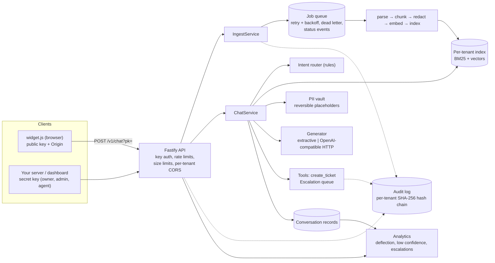
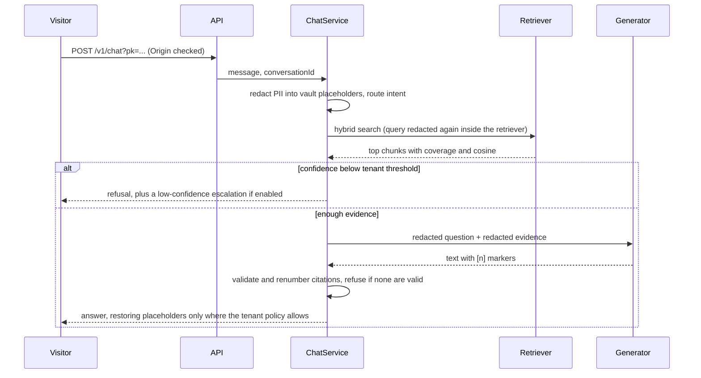

# support-copilot-core

A TypeScript library and a small Fastify HTTP API that implement the backend core of a **multi-tenant, document-grounded support assistant**: tenant isolation, asynchronous document ingestion, hybrid retrieval (BM25 + vectors, fused with Reciprocal Rank Fusion), answers with numbered citations and a refusal path, PII redaction before any model call, a tamper-evident audit log, analytics for an admin dashboard, and an embeddable chat widget.

This is an example / educational project. It has no production deployments, has not been security-audited, and the bundled embedder is a toy. Every limitation I know about is listed below. Everything runs and is tested offline, without API keys.

- [Architecture](#architecture)
- [Quick start](#quick-start)
- [Measured retrieval quality](#measured-retrieval-quality)
- [Answering, confidence and escalation](#answering-confidence-and-escalation)
- [Privacy: PII redaction](#privacy-pii-redaction)
- [Audit log](#audit-log)
- [HTTP API](#http-api)
- [Embeddable widget](#embeddable-widget)
- [Tests](#tests)
- [Limitations](#limitations)
- [Threat model](#threat-model)
- [Dependencies and CI](#dependencies-and-ci)

## Architecture



One chat request, in order:



| Concern | Where | Notes |
|---|---|---|
| Tenancy and roles | `src/tenancy/` | `ScopedCollection` is physically partitioned by tenant id; roles `owner` > `admin` > `agent` |
| Ingestion | `src/ingest/` | parse (markdown / text / HTML) → chunk → embed → index, run by an in-memory queue |
| Retrieval | `src/retrieval/` | own BM25, hashing embedder, OpenAI-compatible embedder, RRF |
| Answering | `src/assistant/` | rule router, extractive and HTTP generators, citation validation, tools, escalation queue |
| Privacy | `src/privacy/` | detectors, reversible vault |
| Audit | `src/audit/` | memory and JSONL logs, verifier |
| Analytics | `src/analytics.ts` | computed from conversation records |
| API and widget | `src/api/`, `src/widget/widget.js` | Fastify routes, token-bucket limiter, one-file widget |
| Evaluation | `src/eval/` | fixture corpus, labelled questions, metrics, threshold calibration |

Runtime dependency: `fastify` only. BM25, vector search, the queue, the limiter, redaction and the audit chain are implemented in this repository.

## Quick start

Requires Node 22.12 or newer.

```sh
npm ci --ignore-scripts
npm run typecheck
npm test                 # 445 tests, offline
npm run build
npm run eval             # prints the retrieval evaluation below
npm run worst-case       # times ingestion of hostile documents (see "Hostile documents: what was measured")
node dist/cli.js --demo  # API on 127.0.0.1:3000 with a demo tenant; keys are printed to stdout
```

`--demo` creates a tenant ("Ledgerly demo", a made-up bookkeeping product), ingests the 18 fixture help-centre documents, and prints a random owner key and public widget key. They only live as long as the process, because all state is in memory. Configuration is by environment variable; see the comment at the top of `src/cli.ts`: `PORT`, `HOST`, `OPERATOR_TOKEN`, `AUDIT_LOG_PATH`, `AUDIT_HMAC_KEY` (at least 32 characters; turns the audit chain into an HMAC), `TRUSTED_PROXIES` (a hop count such as `1`, or comma-separated proxy addresses/CIDRs; unset means `X-Forwarded-For` is ignored), and the optional `EMBEDDINGS_*` / `LLM_*` settings for OpenAI-compatible endpoints. Rate limits and the document CPU budget are library options (`ApiOptions.limits`, `IngestDeps.processingBudgetMs`).

Library use:

```ts
import { Core } from "support-copilot-core";

const core = new Core();                         // offline embedder + extractive generator
const { tenant, ownerKey } = core.createTenant({ name: "Acme" });
const owner = { tenantId: tenant.id, keyId: ownerKey.record.id, role: "owner" } as const;

core.ingest.submit(owner, { title: "Refunds", content: "# Refunds\nRefunds take 5 business days." });
await core.queue.tick();                         // the HTTP server runs this on a timer instead
const reply = await core.chat.handle({ tenantId: tenant.id, keyId: "k", kind: "api" }, { message: "How long do refunds take?" });
```

## Measured retrieval quality

`npm run eval` ingests the fixture corpus through the real pipeline (18 documents, 47 chunks) and runs 63 hand-written questions: 51 answerable (23 `keyword`: they reuse the document's words; 20 `paraphrase`: same meaning, different words; 8 `typo`) and 12 unanswerable (6 off-topic, 6 near-misses that share vocabulary with the product). A hit means the first relevant **document** appears in the top *k* results. The questions were written once, before looking at any results, and not edited afterwards. 51 questions is a small sample: differences of a few points are one or two questions.

Embedder: the bundled `HashingEmbedder` (512 dimensions, hashed word unigrams, bigrams and character trigrams). It is lexical and knows nothing about synonyms. BM25 uses `k1=1.2, b=0.75` and a plural-only stemmer. RRF uses `k=60`.

All 51 answerable questions:

| Retriever | Questions | hit@1 | hit@3 | hit@5 | MRR |
|---|---|---|---|---|---|
| bm25 | 51 | 60.8% | 76.5% | 76.5% | 0.676 |
| vector | 51 | 54.9% | 66.7% | 74.5% | 0.636 |
| hybrid (RRF) | 51 | 66.7% | 76.5% | 80.4% | 0.728 |

By question kind:

| Kind | Retriever | hit@1 | hit@3 | hit@5 | MRR |
|---|---|---|---|---|---|
| keyword (23) | bm25 | 91.3% | 100.0% | 100.0% | 0.957 |
| | vector | 82.6% | 91.3% | 100.0% | 0.882 |
| | hybrid | 95.7% | 100.0% | 100.0% | 0.971 |
| paraphrase (20) | bm25 | 30.0% | 50.0% | 50.0% | 0.383 |
| | vector | 25.0% | 30.0% | 40.0% | 0.327 |
| | hybrid | 30.0% | 45.0% | 55.0% | 0.410 |
| typo (8) | bm25 | 50.0% | 75.0% | 75.0% | 0.604 |
| | vector | 50.0% | 87.5% | 87.5% | 0.701 |
| | hybrid | 75.0% | 87.5% | 87.5% | 0.826 |

What this says, and what it does not:

- Hybrid has the best MRR overall and the best hit@1 and hit@5, and ties BM25 on hit@3. The gain over BM25 is modest and comes mostly from `typo` questions, where the character n-grams help.
- Hybrid does **not** win everywhere. On 6 of the 51 questions it ranks the right document lower than the better of the two single rankers. Five are paraphrases (for example "Can I get my money back?": bm25 3, vector 4, hybrid 4) and one is a keyword question ("Where is my data hosted?": bm25 2, vector 5, hybrid 3). Fusion averages out a good ranker and a poor one.
- Paraphrase questions are the weak spot for every retriever: at best 55% in the top 5. The toy embedder cannot bridge vocabulary gaps. A real embedding model should do much better, but I have not measured one.
- The vector-only retriever is worse than BM25 here. That is a property of this lexical toy embedder and says nothing about dense retrieval in general.

The script prints the full list of questions where hybrid lost; `test/eval.test.ts` pins these numbers, so the table cannot drift from the code.

## Answering, confidence and escalation

- **Confidence.** RRF scores only encode rank, so they cannot say whether the best chunk is any good. Confidence is the plain average of two absolute signals for the top chunk: idf-weighted coverage of the question's terms and cosine similarity scaled by 0.5. Only the decision threshold is calibrated; the weights were fixed in advance.
- **Calibration** (`src/assistant/confidence.ts`, run by the eval script). The threshold maximises balanced accuracy, the mean of "share of answerable questions answered" and "share of unanswerable questions refused". Measured on the 63 questions, using the confidence of the top hybrid hit:

| Threshold | Answerable answered | Unanswerable refused | Balanced accuracy |
|---|---|---|---|
| calibrated on all questions: 0.369 | 70.6% | 91.7% | 81.1% |
| shipped default: 0.37 | 70.6% | 91.7% | 81.1% |
| calibrated on even-numbered questions (0.408), tested on odd | 64.0% | 100.0% | 82.0% |
| calibrated on odd-numbered questions (0.369), tested on even | 61.5% | 83.3% | 72.4% |

  The shipped default (`ANSWER_THRESHOLD` in `src/assistant/calibration.ts`) is 0.37, the all-question value rounded to two decimals. The calibration is fitted on the same questions it is measured on, which is why the held-out rows are shown. Mean confidence: answerable 0.545, unanswerable 0.313.

  In plain terms: with this embedder, about 3 in 10 answerable questions are refused, and one of the 12 unanswerable questions (the Slack-integration near-miss) is still answered, with the caution prefix. The held-out rows (72% to 82% balanced accuracy) are the more honest estimate. A different corpus or embedder needs its own calibration.
- **Caution band.** Answers whose confidence is within `cautionMargin` (default 0.1) above the threshold are prefixed with "I'm not fully certain...".
- **Grounding check.** The generator is not trusted. Citation markers pointing at sources that were not supplied are removed, citations are renumbered in order of use, and an answer with no valid citation is rejected and treated as a refusal.
- **Intent routing.** `RuleBasedRouter` recognises greetings, thanks, "talk to a human", and "open a ticket" with simple patterns; everything else is a question. "How do I open a ticket?" is a question, not a request. The router is an interface; it recognises only the phrasings it was written for.
- **Tools.** `create_ticket` is invoked by the router, not chosen by a model. Arguments are validated, a tenant id is never an argument, and every call (successful or not) is written to the audit log without the ticket text.
- **Escalation.** A human request, or (if the tenant keeps `escalateOnLowConfidence` on) a refusal, opens an entry in the escalation queue. At most one open escalation exists per conversation. Agents claim and resolve entries through the API.
- **Generators.** `ExtractiveGenerator` (default) quotes the best-matching evidence sentences with their `[n]` markers; it cannot paraphrase. `OpenAiCompatibleGenerator` calls `POST /chat/completions` with the sources in delimited blocks, a system prompt that marks sources and the question as untrusted data, and `INSUFFICIENT_EVIDENCE` as the refusal marker. It is tested against a fake `fetch` only; I have not run it against a real model. If the configured generator throws, the extractive generator answers instead and the turn is flagged `generatorFallback`.

## Privacy: PII redaction

`findPii` detects emails (including `[at]`/`(dot)` spellings), phone numbers, card numbers (13-19 digits with a Luhn check; digits may be separated by up to two of space, dot, dash, slash or underscore), IBANs (mod-97 checksum), and national-id-like numbers (US SSN, UK NINO, Vietnamese 12-digit citizen ids, and keyword-introduced passport/id numbers). Detection runs on an NFKC-normalised copy of the text with zero-width characters and standalone combining marks removed and non-ASCII digits and dashes folded, then maps spans back to the original, so full-width digits, odd dashes, zero-width joiners or combining marks between digits do not hide a match. Overlaps are resolved by priority (card, IBAN, email, national id, phone) in time linear in the text.

```
EMAIL: "jane [at] example [dot] com"
PHONE: "+84 912 345 678"
CARD: "4111-1111-1111-1111"
IBAN: "DE89 3704 0044 0532 0130 00"
NATIONAL_ID: "123-45-6789"

static : Hi, I'm [EMAIL], phone [PHONE], card [CARD], IBAN [IBAN], ssn [NATIONAL_ID].
vault  : Hi, I'm [EMAIL_1:a1b2c3d4], phone [PHONE_1:a1b2c3d4], card [CARD_1:a1b2c3d4], IBAN [IBAN_1:a1b2c3d4], ssn [NATIONAL_ID_1:a1b2c3d4].
restore (policy user): Hi, I'm jane [at] example [dot] com, phone +84 912 345 678, card [CARD], IBAN DE89 3704 0044 0532 0130 00, ssn [NATIONAL_ID].
restore (policy none): Hi, I'm [EMAIL], phone [PHONE], card [CARD], IBAN [IBAN], ssn [NATIONAL_ID].
```

(Output of a short script against `dist/`; the card and IBAN are public test values.)

Where redaction is applied:

- **Embedders and generators are wrapped** (`RedactingEmbedder`, `RedactingGenerator`), so raw PII cannot reach them even if a caller forgets. The retriever also redacts queries itself.
- **Documents:** chunks are indexed and embedded in redacted form (`[EMAIL]`); the original chunk text is kept only to build answers, and goes through the vault before a generator sees it.
- **Conversations** store the customer's message and the reply with static tags only. Job errors, audit details and escalation text are redacted too.
- **Reversible placeholders.** For one request, a `PiiVault` swaps PII for `[KIND_n:nonce]` placeholders. The nonce is 24 random letters (about 113 bits) per request, so text from a document or a user cannot forge one; it is letters only on purpose, because the redaction wrappers re-scan placeholders and a hex nonce would occasionally contain a run that passes the IBAN or card checksum and get mangled (an earlier version with an 8-hex-digit nonce had that latent bug; a test now draws 3,000 vaults to check it cannot happen). The final reply restores placeholders only as the tenant's `piiRestore` policy allows: `none`, `user` (default: values the customer typed) or `all` (also values from documents, for example a support address in the help centre). Card numbers and national ids are never restored. Everything not restored becomes a static tag, so a placeholder never leaves the service.
- **Tickets** keep the contact email or phone the customer gave in a separate `contact` field so a human can reply; the ticket body has PII replaced.
- **Chunk boundaries.** Chunks are cut at sentence ends, then whitespace, and never through a card number, IBAN, phone number, email or id that the detectors recognise, so a number straddling a boundary is not left half-visible in the index, the embeddings or the generator input. A recognised span longer than the chunk size (only possible with a very small configured size) is the one exception.

This is pattern matching. It does not find names, street addresses or PII written as free text, it can flag harmless numbers (any 10 to 15 digit run that looks like a phone number), and unusual formats will slip through. Spelled-out digits and email addresses written as "jane at example dot com" without brackets are not detected, deliberately: matching them would redact ordinary prose. `test/pii.test.ts` covers adversarial formatting (obfuscated emails, zero-width characters, combining marks, full-width and Arabic-Indic digits, non-breaking spaces, extra separators, IBANs followed by words, near-miss dates, versions and IP addresses) but cannot prove completeness.

## Audit log

Sensitive actions append an entry: document ingest and delete, job retry, tool calls, escalation create and update, key issue and revoke, role changes, settings changes, tenant creation. Each tenant has its own chain: `hash = H(canonical JSON of {seq, at, tenantId, actor, action, target, details, prevHash})`, starting from a genesis hash of zeros, where `H` is SHA-256 by default and HMAC-SHA-256 when a key is configured (`AUDIT_HMAC_KEY`, or the `hmacKey` option). `verifyEntries` checks contiguous sequence numbers, links and recomputed hashes. `JsonlAuditLog` also appends each entry as one JSON line, and `verifyJsonlFile` verifies the file as it is on disk without trusting memory:

```
before tampering: {"t1":{"ok":true,"entries":3,"head":{"seq":3,"hash":"9ccf3b0dad151cad..."}}}
after editing entry 2: {"t1":{"ok":false,"entries":3,"brokenAtSeq":2,"reason":"hash does not match entry contents"}}
```

Opening an existing JSONL file verifies every tenant's chain first and throws `AuditIntegrityError` if one is broken, so a tampered log stops the service instead of being extended; a torn last line (what a crash during an append leaves) is dropped and the file rewritten without it. `GET /v1/audit/head` returns the newest entry's sequence number and hash; store it somewhere the log writer cannot modify and pass it back as `/v1/audit/verify?headSeq=...&headHash=...` (or `expectedHead` in code) to detect truncation or a rewritten history later.

Tests cover edited fields, deleted, reordered and spliced entries, a forged entry whose own hash was recomputed, a rewritten chain, keyed chains, verification on open and torn lines. **What it does not do:** without a key, an attacker who can write the file can recompute every hash; with a key they also need the key, which must live outside the log's storage (an environment variable on the server, not next to the file). Dropping the newest entries is only detected against a head you recorded elsewhere. The log is tamper-evident, not tamper-proof, and it is never pruned.

## HTTP API

All bodies are JSON. Errors have the shape `{"error": {"code", "message"}}` and never contain stack traces or input values. Management endpoints take `Authorization: Bearer <secret key>` (or `X-API-Key`). The tenant is always taken from the key, never from the request. Roles: `agent` reads content and works the ticket and escalation queues; `admin` also manages documents, settings, analytics and audit; `owner` also manages keys and roles.

| Endpoint | Role | Purpose |
|---|---|---|
| `GET /healthz`, `GET /widget.js` | public | health, the widget script |
| `POST /v1/chat` (`?pk=` public key, or secret key) | public key + allowed Origin, or any secret key | ask a question |
| `OPTIONS /v1/chat?pk=` | public | CORS preflight, checked against the tenant's allow-list |
| `POST /v1/documents`, `GET /v1/documents`, `GET /v1/documents/:id`, `DELETE /v1/documents/:id` | admin (agent may read) | ingest, poll status, delete |
| `GET /v1/jobs[?status=]`, `GET /v1/jobs/:id`, `POST /v1/jobs/:id/retry` | agent read, admin retry | queue state and dead letters |
| `POST /v1/search` | agent | run bm25, vector or hybrid search directly |
| `GET /v1/conversations[/:id]` | agent | transcripts (PII already redacted) |
| `GET /v1/tickets[/:id]`, `POST /v1/tickets/:id/close` | agent | tickets |
| `GET /v1/escalations`, `POST /v1/escalations/:id/claim`, `.../resolve` | agent | human queue |
| `GET /v1/analytics/summary\|timeseries\|unanswered` | admin | dashboard data (`from`, `to`, `limit`) |
| `GET /v1/audit`, `GET /v1/audit/head`, `GET /v1/audit/verify[?headSeq=&headHash=]` | admin | audit entries, newest chain head, chain verification (optionally against a recorded head) |
| `GET /v1/keys`, `POST /v1/keys`, `PATCH /v1/keys/:id`, `DELETE /v1/keys/:id` | admin read; owner write | keys and roles |
| `GET /v1/settings`, `PATCH /v1/settings` | admin | allowed origins, PII policy, thresholds |
| `POST /v1/operator/tenants` | operator token | creates a tenant; the route does not exist unless `OPERATOR_TOKEN` is set |

Controls: keys are `scs_<id>_<secret>` (secret) or `scp_<id>_<secret>` (public); only the SHA-256 of the 256-bit secret is stored and comparison is constant-time. Token-bucket limiters apply per client address before authentication (120 per minute, burst 60), per key (300 per minute, burst 120), to failed authentications (10 per minute), to widget chat per client address (20 per minute, burst 10) and to chat per key as an aggregate (300 per minute, burst 60). Client addresses come from the socket unless `trustProxy` names a hop count or proxy addresses; IPv6 clients share a bucket per /64. Chat bodies are capped at 16 KiB, other bodies at 1.5 MB, document content at 1,000,000 bytes, chat messages at 2,000 characters. Only `application/json` is accepted (a `text/plain` body would be a "simple" cross-origin request that skips the preflight). Unknown body properties are rejected.

Real output from `node dist/cli.js --demo` (random ids and keys differ per run; the request bodies are abbreviated here):

```text
GET /v1/documents without a key
HTTP 401  {"error":{"code":"unauthorized","message":"Missing or invalid API key."}}

POST /v1/documents {"title":"Shipping FAQ","content":"# Shipping FAQ\n\n## Delivery times\n..."}
HTTP 202
{
  "document": { "id": "doc_4rvCdbgrFLvaI3Fs", "title": "Shipping FAQ", "format": "markdown", "bytes": 204,
                "status": "queued", "jobId": "job_gr_TOJou9YKoixQa", "chunkCount": 0, "error": null, ... },
  "jobId": "job_gr_TOJou9YKoixQa",
  "duplicate": false,
  "statusUrl": "/v1/documents/doc_4rvCdbgrFLvaI3Fs"
}

GET /v1/documents/doc_4rvCdbgrFLvaI3Fs   (polled until the queue had processed it; fields trimmed)
HTTP 200  {"document":{"status":"ready","chunkCount":2},"job":{"status":"succeeded","attempts":1,"stage":"index"}}

POST /v1/documents (same content again)
HTTP 200  {"duplicate":true, ...}
```

Chat from the widget (public key, `Origin: https://shop.example` allowed for the demo tenant):

```text
POST /v1/chat?pk=scp_...   {"message":"How do I reset my password?"}
HTTP 200
{
  "conversationId": "conv_hko5reg6SvQxprlH",
  "intent": "question",
  "outcome": "answered",
  "answer": "On the sign-in page choose \"Forgot password\" and enter your email address. [1] We send a reset link that is valid for 30 minutes. [1]",
  "confidence": 0.8733425594817928,
  "citations": [ { "n": 1, "documentId": "doc_DIsr6Ytsp9DaZ2ZU", "chunkId": "doc_DIsr6Ytsp9DaZ2ZU:0",
                   "title": "Resetting your password > Forgot your password",
                   "snippet": "On the sign-in page choose \"Forgot password\" and enter your email address. We send a reset link ..." } ],
  "escalation": null,
  "ticket": null
}

POST /v1/chat?pk=scp_...   {"message":"What is the weather in Berlin today?", "conversationId":"conv_hko5reg6SvQxprlH"}
HTTP 200
{
  "intent": "question",
  "outcome": "refused",
  "answer": "I couldn't find a reliable answer to that in the documentation, so I won't guess. I've asked our support team to follow up.",
  "confidence": 0.3116792774556127,
  "citations": [],
  "escalation": { "id": "esc_rVjFHr69uzZrVKSZ", "reason": "low_confidence" },
  ...
}

POST /v1/chat?pk=scp_...   {"message":"jane@example.com here, card 4111 1111 1111 1111: how many business days does a refund take?"}
HTTP 200
{
  "outcome": "answered",
  "answer": "Refunds go back to the original payment method and take 5 to 10 business days to appear, depending on your bank. [1]",
  "confidence": 0.6123185810383873,
  "citations": [ { "n": 1, "title": "Refund policy > How refunds are paid", ... } ],
  ...
}

POST /v1/chat?pk=scp_...   {"message":"Please open a ticket about my export that never arrives, call me on +1 415 555 2671"}
HTTP 200  {"intent":"create_ticket","outcome":"ticket_created","answer":"I've opened ticket tkt_A92COKL3dJp7gpiJ. Someone from the team will follow up.", ...}

POST /v1/chat?pk=scp_... from Origin: https://evil.example
HTTP 403  {"error":{"code":"forbidden","message":"Origin is not allowed for this key."}}

OPTIONS /v1/chat?pk=scp_... from Origin: https://shop.example
HTTP 204  access-control-allow-origin: https://shop.example   access-control-allow-methods: POST, OPTIONS
```

Dashboard data and the human queue after those requests (secret key):

```text
GET /v1/analytics/summary
{ "conversations": 3, "engagedConversations": 3, "deflectedConversations": 1, "deflectionRate": 0.3333333333333333,
  "questions": 3, "answered": 2, "answeredWithCaution": 0, "refused": 1,
  "lowConfidenceAnswers": 1, "lowConfidenceRate": 0.3333333333333333, "averageConfidence": 0.5991134726585976,
  "ticketsCreated": 1, "escalations": { "total": 1, "open": 1, "byReason": { "user_request": 0, "low_confidence": 1 } }, ... }

GET /v1/escalations   -> [{"reason":"low_confidence","status":"open","summary":"Customer question: What is the weather in Berlin today?"}]
GET /v1/tickets       -> [{"subject":"my export that never arrives, call me on [PHONE]","body":"my export that never arrives, call me on [PHONE]","contact":"+1 415 555 2671"}]
GET /v1/audit/head    -> {"head":{"seq":23,"hash":"fdaeb061c1d7007e9d20e3b2d25bb2d73830bb5ecf1a64ddb2b4fb8896491d15"}}
GET /v1/audit/verify  -> {"ok":true,"entries":23}
GET /v1/audit/verify?headSeq=23&headHash=fdaeb0...1d15 -> {"ok":true,"entries":23}
GET /v1/audit/verify?headSeq=23&headHash=0000...0000   -> {"ok":false,"entries":23,"brokenAtSeq":23,"reason":"entry at the recorded head does not match"}
```

Definitions: a conversation is *engaged* if it has a question, ticket request or human request (not just "hello"); it is *deflected* if it got at least one answer and ended without a ticket or escalation. *Low-confidence answers* are refusals plus answers shown with the caution prefix.

The refund question above contained an email address and a card number; the generator only saw `[EMAIL_1:...]` and `[CARD_1:...]` placeholders, and the reply contains neither. Separately, a support address that comes from a help-centre document is shown as `[EMAIL]` in answers under the default `piiRestore: "user"` policy; set it to `all` to show addresses from your own documents.

## Embeddable widget

```html
<script src="https://YOUR-API/widget.js" data-key="scp_..." data-title="Help"></script>
```

`src/widget/widget.js` is one framework-free file (about 15 KB, no build step). The tenant's public key is sent in the query string of `POST /v1/chat` so the CORS preflight (which carries no custom headers) can be checked against that tenant's allow-list of exact origins. A public key only works from an allowed `Origin`; that is a guard against other websites embedding your key, not authentication: any non-browser client can send any `Origin` header. What bounds abuse of a public key is the limiter: each client address may send 20 chat requests per minute, below the key's shared aggregate of 300, so one address cannot use up the quota other visitors depend on (a client with many source addresses still can), and a public key can only call the chat endpoint.

How it was tested: the pure logic (config validation, request building, response parsing, citation splitting, conversation-id storage, the client) is loaded into a bare `vm` context with no `window` or `document` and tested with fake `fetch` and storage. The DOM-building code runs against a small hand-written fake document, which checks that server text only ever becomes text nodes and that the source never uses `innerHTML` and similar. **It has not been run in a real browser.** Layout, CSS, focus handling, real `fetch`/CORS behaviour and accessibility with a screen reader are untested.

## Tests

`npm test` runs 445 tests with Vitest in a few seconds. No network or API keys. The suite includes:

| File | Tests | Covers |
|---|---|---|
| `tenancy.test.ts` | 33 | tenant-partitioned storage: every method of `ScopedCollection` is attacked as another tenant (and a guard test fails when a method is added without a case); roles; API keys; settings validation |
| `isolation.test.ts` | 9 | tenant B's owner uses tenant A's ids through documents, jobs, conversations, tickets, escalations, keys, audit, analytics, retrieval; a guard lists every service method |
| `pii.test.ts` | 49 | detectors with adversarial formatting and padding, false-positive controls, offsets, overlap resolution, vault placeholders, forged placeholders, restore policy, nonce properties |
| `audit.test.ts` | 31 | hash chain, modification, deletion, reordering, forgery, truncation, per-tenant chains, keyed (HMAC) chains, JSONL on disk, verification when a file is opened, torn final lines |
| `ingest.test.ts` | 59 | HTML to text safety, markdown parsing and inline rules, format sniffing, chunking (including PII-safe cut points), processing budget (with a fake clock), queue retries and dead letters, idempotency, deletes during processing |
| `worst-case.test.ts` | 25 | about 1 MB of hostile content per parser family finishes in well under a few seconds; the event loop keeps running during ingestion; budget exhaustion is a permanent failure |
| `retrieval.test.ts` | 33 | tokenizer, BM25 formula, RRF, embedders (including the HTTP one with a fake `fetch`), retriever isolation |
| `chat.test.ts` | 77 | routing, citations, refusal, escalation, `create_ticket`, tool registry, PII on the way to embedders and generators, composer validation, HTTP generator with a fake `fetch`, conversations, concurrent turns, queue and conversation caps |
| `eval.test.ts` | 13 | fixtures, pinned README numbers, calibration, held-out threshold check |
| `analytics.test.ts` | 8 | deflection, low confidence, windows, time series, unanswered questions |
| `admin.test.ts` | 11 | escalation workflow, roles, key and role changes, audit of administrative actions |
| `api.test.ts` | 56 | auth, roles, tenant scoping over HTTP, rate limits (per IP, per key, per widget client, IPv6 prefixes, proxy trust), size limits, safe errors, CORS and origins, operator endpoint, document flow, audit head anchoring, management endpoints |
| `widget.test.ts` | 41 | widget logic and fake-DOM rendering (see above) |

## Limitations

- **Toy embedder.** The hashing embedder is lexical. Paraphrase retrieval is weak (see the table). The OpenAI-compatible embedder and generator are tested against fakes only; I have not verified them against a real provider or model, and the confidence formula and thresholds were calibrated only for the hashing embedder.
- **In-memory everything.** Documents, vectors, the queue, conversations, tickets and keys vanish on restart. Only the audit log can optionally be appended to a JSONL file; it is verified when reopened but not used to rebuild any other state. Brute-force vector search is fine for thousands of chunks per tenant, not millions.
- **Queue.** The reference queue is single-process: no durability, no cross-process locking, no visibility timeout. It demonstrates the interface (retries with backoff, dead letters, status events); production would need a real broker behind the same interface.
- **Document processing shares the event loop.** Parsing, chunking and redaction run on the main thread with cooperative yielding and a CPU budget (see "Hostile documents" below). That bounds the stall from a hostile document to roughly 100 ms in the measurements here, but it is not isolation: a step that never reaches a yield point cannot be interrupted. A worker thread or process would be stronger and is not implemented.
- **Rate limiting** is per process and in memory. The widget limit is per client address (IPv6 per /64), so many visitors behind one NAT share it (default 20 chat requests per minute, burst 10; configurable through `ApiOptions.limits`). A client with many distinct source addresses can still spread load past it.
- **Retention.** Conversations are capped at 10,000 per tenant (the oldest without an open escalation are dropped), and open tickets and open escalations at 1,000 each. The audit log is append-only and is never pruned, so it grows with administrative and tool activity.
- **No real LLM verified.** The extractive generator is the only one used in tests and in the numbers above. Real models can still follow instructions hidden in documents; the guard rails reduce that risk (delimited, untrusted-data prompt, citation validation, redacted input) but do not remove it.
- **Rule-based routing** misreads phrasing it was not written for.
- **Conversation ids are capability tokens:** anyone holding one can continue that conversation through the same kind of key. There is no per-visitor authentication.
- **Retrieval evaluation** uses a made-up help centre and 63 questions I wrote. It is a regression test and a demonstration of method, not a benchmark.
- **PII redaction** is pattern based (see above). English and a few national formats only; spelled-out digits and unbracketed "at"/"dot" email spellings are not detected on purpose.
- **Audit chain** is tamper-evident, not tamper-proof (see above).
- No UI beyond the widget, no authentication for human agents beyond API keys, no billing, no persistence, no deployment manifests.

## Threat model

Assets: tenants' documents and conversations; customers' PII; API keys; the audit log; the availability of the single process that serves all tenants. Everything below was reasoned about and tested where noted; the hostile-input figures are measured and quoted in the next section. None of it has been reviewed by a third party beyond one internal review pass whose findings are reflected here.

| Threat | Mitigation | Residual risk |
|---|---|---|
| One tenant reads or changes another's data | Every store method takes the tenant id first and works only inside that tenant's partition; the tenant id comes from the authenticated key, never from request input; per-tenant search indexes (no shared term statistics); tests attack every method | A bug in a new code path that skips the scoped store. The guard tests only catch new methods on the classes they list |
| Stolen or guessed API key | 256-bit random secrets, only SHA-256 stored, constant-time compare, revocation, role changes take effect on the next request, failed-auth throttling | A leaked key works until revoked. No key expiry or IP binding |
| Low-privilege key escalates | Role matrix enforced in the service layer (not only in routes); last owner cannot be demoted or revoked; role changes and key issuance audited | Roles are coarse (three levels) |
| Another website abuses a public widget key | Exact-origin allow-list per tenant, checked on preflight and on every request; JSON-only bodies (no preflight bypass); chat-only scope | The `Origin` header is not authentication; a script outside a browser can forge it. Public keys are visible to anyone who views the page |
| One client uses up the shared widget quota (forged `Origin` plus the public key) | A per-client-address limit sits in front of the per-key aggregate limit, so one address can spend only its own share; requests with a wrong `Origin` are rejected before they spend any quota; the aggregate default (300 per minute) is larger than any single address can reach (20 per minute) | A distributed client, or one with many source addresses, can still exhaust the aggregate. Visitors behind one NAT share one address's allowance |
| Spoofed `X-Forwarded-For` to dodge IP limits | The header is ignored unless `ApiOptions.trustProxy` / `TRUSTED_PROXIES` names a hop count or proxy addresses; with a hop count only the entry appended by the trusted proxy counts and client-supplied entries are ignored; there is no "trust everything" option; IPv6 clients are keyed by /64 | The proxy must append the real client address (the default behaviour of common proxies). The limiter map holds 10,000 clients and evicts the least recently used when full, so a flood of genuinely distinct addresses can evict others' buckets |
| Anonymous traffic fills memory, the human queue or the audit log | Open tickets and escalations are capped at 1,000 each per tenant (a full queue answers "queue is full" without writing audit entries); conversations are capped at 10,000 per tenant with the oldest pruned; 50 turns per conversation; per-address chat limit | The audit log is never pruned, and a tenant at its cap is a denial of the human-queue feature for that tenant until staff clear it |
| PII sent to an embedding or LLM provider | Wrapped embedders and generators redact before the call; redacted indexes; placeholders carry a 24-letter random per-request nonce (letters only, so no detector can ever match inside a placeholder); chunk boundaries never cut through a detected card, IBAN, phone number, email or id; card numbers and national ids are never restored; stored conversations hold static tags | Undetected PII (names, addresses, spelled-out digits, unusual formats) is sent as-is. Whatever the provider does with data is out of scope |
| Prompt injection through documents or messages | Evidence and question are passed as delimited, labelled untrusted data; citations are validated and uncited answers rejected; tools are chosen by rules, take no tenant argument, validate arguments and are audited | A model can still be steered into a misleading answer that cites a real source |
| Hostile HTML or markdown in uploads | HTML is tokenised and markdown scanned by hand-written linear scanners, not regular expressions: script/style/iframe and similar are dropped with contents, attributes are never read, entities decoded once through a map (no inherited-property lookups); output is plain text served as JSON; the widget renders text nodes only | Escaped markup in a document (`&lt;b&gt;`) stays as literal text. Any other consumer that renders text as HTML must escape it |
| Hostile documents stall the process that serves every tenant (regex backtracking, huge tokens, format sniffing) | See "Hostile documents" below: linear scanners, 8,192-character line cap, 1,000,000-byte and 1,000-chunk limits, no chunk over 600 characters, linear PII overlap resolution, cooperative yielding about every 10 ms and a 4 s CPU budget per document that fails the document permanently | Cooperative, not isolated (see Limitations). Worst measured stall with the fix: 105 ms |
| Audit log tampering | Per-tenant SHA-256 chain, or HMAC-SHA-256 with `AUDIT_HMAC_KEY`; verifier endpoint and file verifier; an existing file is verified when opened and the process refuses to start on a broken chain; a torn last line from a crash is repaired; details redacted before hashing; the chain head can be fetched and later passed back to catch truncation | Without a key, anyone who can write the file can recompute the chain. With a key they also need the key. Dropping the newest entries is detected only against a head you stored elsewhere |
| Resource exhaustion | Body limits (16 KiB chat, 1.5 MB otherwise), document size, count and chunk limits, bounded rate-limiter memory, bounded conversation length, bounded job history, source text kept out of the records that get cloned on every list | Per-process limits only; a distributed attacker is out of scope |
| Information leakage in errors | One error handler: known errors map to fixed messages, everything else is a generic 500; the application never logs request bodies | The server log (when enabled) contains request lines, including the public key in the `?pk=` query string, which is public by design |
| Misconfiguration | Allowed origins reject `*`, paths and non-http(s) schemes; the operator endpoint is absent unless a token is set; the server binds to 127.0.0.1 by default | TLS, secrets storage and network exposure are the deployer's job |
| Server-side request forgery | The embedder and generator base URLs come only from operator environment variables, never from tenants or requests | An operator who points them at an internal host gets what they asked for |

Out of scope: denial of service at network scale, supply-chain compromise beyond the pinning described below, anything about the LLM or embedding provider's own handling of data.

### Hostile documents: what was measured

Any admin key can upload a document of up to 1,000,000 bytes in a format it chooses. The first version parsed markdown and HTML with backtracking regular expressions (lazy quantifiers over whole lines, `\s+$`, nested optional groups) and sniffed the format with regular expressions over the whole upload, all on the one thread that also serves every other tenant. `scripts/worst-case.mjs` (`npm run worst-case`) runs hostile inputs through `Core.ingest.submit` and one queue tick, each in its own process, and reports the longest time a 1 ms timer could not fire (the "stall"). Same inputs, same machine (Node 22.22 in a Docker container on a Mac), before and after the change:

| Input (format) | Before: event loop blocked | After |
|---|---|---|
| `[` x 262,144 (markdown) | 51,487 ms | 10 ms |
| `# ` then `#` x 262,144 (markdown) | 71,295 ms | 46 ms |
| `<p>a`, 262,144 spaces, `x</p>` (html) | 73,724 ms | 10 ms |
| `a`, 262,144 spaces, `x` (markdown) | 34,931 ms | 9 ms |
| `[a](` x 65,536 (markdown) | 533 ms | 23 ms |
| ` *a` x 262,144 (markdown) | 9,004 ms | 62 ms |
| `<a ` x 262,144, format auto (in the request handler) | 8,881 ms | 69 ms |
| 262,144 newlines then `x`, format auto (in the request handler) | 65,034 ms | 7 ms |
| `<!--` x 250,000 = 1,000,000 characters (markdown) | 48,345 ms | 39 ms (990,000 chars) |
| `415-555-2671,` x 20,000 (text, one chunk before) | 620 ms | 49 ms |

Quadratic behaviour shows as roughly 16 times the time for 4 times the input: `[` went from 3,178 ms at 65,536 characters to 51,487 ms at 262,144. The 1,000,000-character figure above (the comment case) is the only one measured at that size before the change; for the other cases, extrapolating the same growth from 262,144 characters would give roughly 2 to 18 minutes each, but I did not run them. After the change every hostile input in the script, including 990,000-character ones, keeps the loop blocked for at most 105 ms (typically 10 to 70 ms), and many are rejected quickly (more than 1,000 chunks, or no extractable text). `test/worst-case.test.ts` repeats the 1 MB cases with generous limits (3 s per document, 750 ms of event-loop stall) so a return of quadratic behaviour fails the build; those limits are 25 to 100 times the measured times on purpose, because CI machines are slower and noisier. A legitimate 65,536-character markdown document takes about 60 ms end to end.

What changed: scanners are linear (each "no closer exists after here" lookup is remembered, so repeated unclosed openers cost one scan; link and emphasis rules use precomputed lookup tables); lines are wrapped at 8,192 characters before any per-line work; format sniffing reads only the first 32 KB with hand-written checks; chunks are cut at sentence ends, then whitespace, and never through a detected PII span, with a hard cut at 600 characters for text with no boundary; PII overlap resolution uses a mask instead of comparing every pair; loops call a `ProcessingBudget` that yields to the event loop after about 10 ms of work and rejects the document, without retries, after 4 s of CPU time (time spent waiting on an embedding request does not count).

One case needed a closer look: the review suggested `1234567890.` repeated as a worst case for the old PII overlap loop. Measured, that input cost 927 ms for 1,000,000 characters, because most of its windows have more than 15 digits and are not accepted as phone numbers, so there are few candidates to compare. The input that actually triggers the quadratic loop is one where every window is a valid phone number and there is no whitespace to chunk on (`415-555-2671,` repeated): 3,151 ms for 990,000 characters before, 15 ms (and a quick rejection for exceeding 1,000 chunks) after.

## Dependencies and CI

- One runtime dependency (`fastify`) plus TypeScript, Vitest and `@types/node` for development. Versions are exact; `package-lock.json` covers all platforms' optional packages; every locked version, direct and transitive, was published on or before 2026-10-24. `npm ci --ignore-scripts` is used everywhere, so no dependency lifecycle scripts run.
- CI (`.github/workflows/ci.yml`) runs typecheck, tests and build on Node 22 and 24 with a read-only token and no persisted credentials; actions are pinned to full commit SHAs. Dependabot opens weekly npm and Actions updates with a 7-day cooldown.
- Releases: pushing a `v*` tag runs `.github/workflows/release.yml` (see [RELEASING.md](RELEASING.md)), which repeats the checks, builds the package, attests it and creates the GitHub release; it does not publish to npm.
- Vulnerability reports: see `SECURITY.md`.

## Secrets and hooks

Never commit `.env` files or credentials. Keep real values in an untracked `.env` and document the variable names in `.env.example` with placeholders only.

Install [lefthook](https://github.com/evilmartians/lefthook) and run `lefthook install` once per clone. This enables two hooks:

- `pre-commit` scans the staged changes (`sh scripts/secret-scan.sh --staged`).
- `pre-push` scans the whole tree (`sh scripts/secret-scan.sh --tree`).

CI also runs the tree scan and a full-history scan (`--history`). The scanner is a dependency-free POSIX shell script that looks for forbidden file names (such as `.env` or private key files) and for key-shaped values, and it never prints the matched value. A reviewed false positive can be allowed in `.secret-scan-allow` with one line per file and rule, `<path> <rule>   # reason`, or on a single line with the marker `secret-scan: allow`.

If a secret is ever committed, rotate it first, treating it as compromised, and only then remove it from history.

## Releasing

Releases are cut by pushing a `vMAJOR.MINOR.PATCH` tag. The `release` workflow then verifies the code, builds the files, writes `SHA256SUMS`, attests where they were built and creates the GitHub release. See [RELEASING.md](RELEASING.md) for how to cut a release and how to verify a download with `gh attestation verify`.

## License

MIT. See `LICENSE`.
